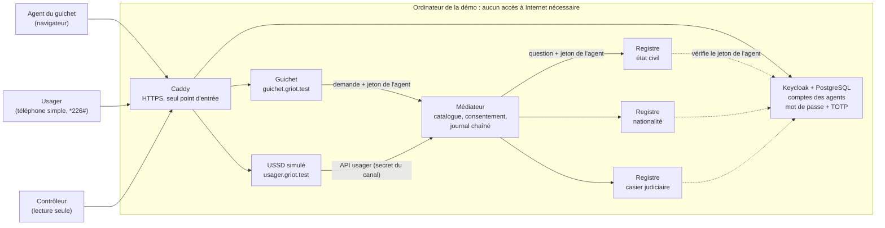

# Architecture de Griot Secure

Pour le jury et pour une administration qui voudrait réutiliser le socle.
Décrit le code de `main` au commit `053d043` (17/11/2026). Les règles, sans le logiciel : [REGLES_DU_SOCLE.md](REGLES_DU_SOCLE.md).

## En une phrase

Un **médiateur** fait circuler entre administrations des réponses courtes (« oui » / « non »). Ces réponses sont
**signées** par l'administration qui détient la donnée. L'usager **voit avant** ce qui part et **vérifie après**
qui a consulté ses données.

## Schéma

Les flèches pleines sont des appels. Les flèches en pointillés montrent qu'un registre lit les clés publiques de
Keycloak pour vérifier lui-même le jeton de l'agent.

Tous les réseaux Docker sont **sans sortie vers Internet** (`internal: true` dans `docker-compose.yml`), sauf le
réseau de Caddy, qui ne sert qu'à publier les ports 80 et 443 sur l'ordinateur. Le guichet n'est **pas** sur le
réseau des registres : il ne peut pas contourner le médiateur.

## Rôle de chaque composant

| Composant | Dossier | Rôle |
|---|---|---|
| **Caddy** | `caddy/` | Seule porte d'entrée, en HTTPS avec son autorité de certification interne (`tls internal`, pas de Let's Encrypt). En-têtes de sécurité ; aucun script autorisé dans les pages. Ne publie ni le médiateur ni les registres |
| **Keycloak** (+ PostgreSQL) | `keycloak/`, `postgres/` | Comptes des agents : mot de passe **et** code TOTP obligatoire, blocage après plusieurs échecs. Le **groupe** de l'agent donne son service. Rôles `agent-guichet` et `controleur` |
| **Guichet** | `guichet/` | Écran de l'agent (FastAPI + Jinja2, sans JavaScript). Propose **seulement** les démarches du catalogue. **Revérifie** chaque signature avec la clé publique du registre. Page `/controle` pour le contrôleur |
| **Médiateur** | `mediateur/` | Applique le catalogue (qui peut demander quoi, pourquoi, sur quelle base). Interroge les registres **en parallèle**, avec un délai maximal. Vérifie les signatures. Garde les réponses en attente de l'accord de l'usager. Tient le **journal chaîné** (SQLite). Limites de débit |
| **Registres** (×3) | `registres_sim/`, `adaptateurs/` | Un seul code, trois instances : état civil, nationalité, casier. Chacun lit **ses** données grâce à un fichier YAML (l'« adaptateur »), calcule la réponse et la **signe avec sa propre clé**. Garde sa propre liste des réponses signées (« double trace ») |
| **USSD simulé** | `ussd_sim/` | Page web qui imite un téléphone simple : `*226#`, écrans de 160 caractères au plus. L'usager confirme ou refuse, consulte son historique, retire un accord |
| **Catalogue** | `catalogue/` | `demarches.yaml` : les démarches. `annuaire.yaml` : les services et les registres. Modifiable sans toucher au code ([AJOUTER_UNE_DEMARCHE.md](AJOUTER_UNE_DEMARCHE.md)) |
| **Vérificateur** | `journal/verifier.py` | Recalcule toute la chaîne du journal, retrouve un reçu, compare le journal aux listes des registres |

Deux conteneurs ne sont **jamais** lancés avec la pile normale : `ocr` (lit un PDF scanné, sans aucun réseau) et
`relais-api-jury` (seulement si le jury impose son API en direct). Voir [JOUR_J_DONNEES_JURY.md](JOUR_J_DONNEES_JURY.md).

## Trajet d'une demande de passeport, pas à pas

Démarche `passeport-ordinaire` : **avec l'accord de l'usager**. Deux questions seulement : « burkinabè ? » et
« interdiction de sortie du territoire ? ». L'état civil n'est pas interrogé.

1. **L'agent se connecte** au guichet : mot de passe puis code TOTP (Keycloak). Son jeton dit qui il est et à
   quel service il appartient.
2. **L'agent choisit** « Passeport ordinaire » et tape l'identifiant de l'usager. Le guichet envoie au médiateur
   un numéro de demande unique, la démarche, la finalité et l'identifiant, avec le jeton de l'agent. **Le service
   vient du jeton, jamais du formulaire.**
3. **Le médiateur contrôle** : la démarche existe, ce service y a droit, la finalité est exactement celle du
   catalogue, et l'agent n'a pas dépassé ses limites. Sinon : refus avec le motif.
4. **Le médiateur interroge en parallèle** le registre de la nationalité et le casier. Il transmet le jeton de
   l'agent. Délai total : 3 secondes par registre (`DELAI_REGISTRE`).
5. **Chaque registre vérifie lui-même** le jeton de l'agent, que ce service a droit à cette question (« double
   clé »), et que le mode (accord ou base légale) est accepté pour ce service. Puis il cherche la personne :
   aucune fiche, plusieurs fiches, donnée incomplète, personne décédée → **refus signé**. Sinon il calcule la
   réponse et la **signe** (JWT EdDSA / Ed25519, valable 10 minutes). Il note la réponse dans sa propre trace,
   sans la personne ni la valeur.
6. **Le médiateur vérifie** chaque réponse : signature avec la clé publique du bon registre, émetteur,
   destinataire, expiration, numéro de demande, numéro unique de réponse jamais vu, forme exacte du contenu.
   Un seul écart : refus et **ligne d'alerte** au journal.
7. **L'usager voit avant.** Sur `*226#` : « L'ONI (passeports) recevra : burkinabè = oui ; interdiction de sortie
   du territoire = non. Rien d'autre. 1. Confirmer 2. Refuser ». Il a 10 minutes (`DUREE_CONSENTEMENT`).
   S'il confirme, il reçoit un **reçu**. S'il refuse ou ne répond pas : rien n'est transmis.
8. **Le guichet reçoit** les réponses signées, **revérifie** chaque signature avec la clé publique lue directement
   dans le volume du registre, et affiche le résultat : « signé par le registre…, signature vérifiée », avec
   l'empreinte courte de la clé. Le médiateur **efface** alors la réponse qu'il gardait.
9. **L'usager vérifie après** : « Qui a consulté mes données » liste qui, quand, pourquoi, sur quelle base, sans
   jamais la valeur. Le reçu se vérifie avec `journal/verifier.py --recu`.

Pour une démarche **en base légale** (concours, majorité), les étapes 1 à 6 sont les mêmes. L'étape 7 n'existe
pas : la réponse est remise tout de suite. La consultation apparaît quand même dans l'historique de l'usager, avec
le texte qui l'autorise.

## Qui voit quoi

| Acteur | Voit | Ne voit jamais |
|---|---|---|
| **Agent du guichet** | Les réponses signées à **ses** demandes (« burkinabè : oui »), ou le motif du refus | La fiche, la date de naissance, la filiation, le détail du casier. Les demandes des autres agents |
| **Médiateur** | L'identifiant de l'usager le temps de la demande. La réponse minimale signée, **gardée seulement jusqu'à la remise ou l'expiration**, puis effacée. Le journal : les faits, l'usager y est **pseudonymisé** (HMAC) | La fiche. La valeur dans le journal. Il ne peut pas fabriquer de réponse : il n'a pas la clé des registres |
| **Registre de l'état civil** | Ses propres fiches. Les questions qu'on lui pose : qui demande (jeton), sur qui, quel attribut | Les réponses des autres registres. Ce que l'usager a confirmé |
| **Registre de la nationalité** | Idem, pour ses fiches | Idem |
| **Registre du casier** | Idem, pour ses fiches | Idem |
| **Usager** | Avant l'envoi : exactement ce qui partira (valeurs comprises, ce sont ses données). Après : qui a consulté, quand, pourquoi, sur quelle base, son reçu, les alertes le concernant | Les données des autres personnes |
| **Contrôleur** (`controle.cil`) | Alertes (agent bloqué, réponse corrompue, refus de registre), état des registres, catalogue en vigueur et son empreinte, vérification du journal | Aucun identifiant ni pseudonyme d'usager, aucune réponse. Il ne peut rien modifier |

Détail de ce que voit le médiateur, et de ce qui n'est pas protégé : [LIMITES.md](../LIMITES.md).

## Signatures et vérification

- **Qui signe ?** Chaque registre, avec **sa** clé privée Ed25519, créée au premier démarrage dans un volume
  Docker que lui seul monte. Elle n'est jamais commitée.
- **Avec quoi ?** La bibliothèque PyJWT (algorithme EdDSA), avec `cryptography`. **Nous n'avons écrit aucune
  primitive cryptographique.** Le journal utilise `hashlib.sha256` ; la pseudonymisation utilise `hmac`, tous deux
  dans la bibliothèque standard de Python.
- **Où est la clé publique ?** Dans un volume par registre. Seul ce registre y écrit ; le médiateur et le guichet le
  lisent en **lecture seule**. Le médiateur ne peut donc ni fournir ni remplacer la clé que le guichet utilise.
- **Le registre signe aussi ses refus.** Un refus non signé est traité comme une réponse corrompue. Seul
  « indisponible » n'est pas signé, puisque le registre n'a pas répondu.
- **Journal chaîné.** Chaque ligne contient l'empreinte SHA-256 de la ligne précédente. Modifier une ligne casse
  la chaîne à cet endroit. SQLite refuse aussi toute modification ou suppression (déclencheurs). Le **reçu** donné
  à l'usager est le début de l'empreinte de sa ligne : si quelqu'un recalculait toute la chaîne, les reçus déjà
  donnés ne correspondraient plus.
- **Double trace.** Chaque registre garde la liste des réponses qu'il a signées (numéro de demande, numéro de
  réponse, date, service, attribut, ok ou refus). `verifier.py --registres` la compare au journal du médiateur.

## Comportement en panne

Règle d'or : **en cas de doute, refuser, ne jamais deviner.**

| Panne | Ce qui se passe | Pour la provoquer |
|---|---|---|
| Registre coupé | « Registre indisponible, rien n'a été deviné », ligne au journal | `python scripts/panne.py <registre> coupe` |
| Registre lent | Abandon après 3 secondes, même message | `python scripts/panne.py <registre> lent` (le registre attend 10 s) |
| Réponse falsifiée en chemin | Signature invalide : refus et ligne d'alerte | `python scripts/panne.py <registre> corrompu` (« non » devient « oui » sans nouvelle signature) |
| Un registre en panne sur trois (concours) | Résultat partiel : chaque registre a sa ligne. **Jamais de « oui » global** | [test-manuel.md](test-manuel.md), scène 1 ter |
| Même demande envoyée deux fois | Une seule exécution, même résultat | même numéro de demande |
| Médiateur injoignable | Le guichet et l'USSD l'affichent, rien n'est deviné | — |
| Wifi coupé | Tout continue : rien ne dépend d'Internet | [test-manuel.md](test-manuel.md), scène 9 |
| Ligne du journal modifiée dans le fichier | `verifier.py` donne le numéro de la ligne | `python scripts/falsifier_journal.py` |

Retour à la normale : `python scripts/panne.py <registre> normal`. Le banc automatique
(`python scripts/banc_de_pannes.py`) rejoue ces scénarios. Il sert avant la démo, pas devant le jury
([test-manuel.md](test-manuel.md)).

## Pourquoi pas de base centrale

Une base qui copierait l'état civil, la nationalité et le casier permettrait de **tout croiser** sur chacun, et
deviendrait la cible la plus intéressante pour un attaquant. Ici, **chaque registre garde ses données** et ne
répond qu'à des questions prévues à l'avance. Le médiateur ne stocke aucune fiche. Il garde une réponse minimale
quelques minutes au plus, et un journal de faits sans valeurs.

C'est aussi la règle 10 du socle : une donnée fausse se corrige **à la source**. Il n'y a pas de copie à corriger
ailleurs. La loi n°001-2021/AN demande des données « adéquates, pertinentes et non excessives »
([source](https://assembleenationale.bf/storage/Loi/kDsWHXOTUCQFVESChh8BlBdiZnCrdTsOpXe1rzmH.pdf)) : la réponse
« burkinabè : oui » suffit pour le passeport, la copie du certificat de nationalité n'est pas nécessaire.

## Pourquoi pas X-Road, et comment y aller

X-Road est une couche d'échange de données libre utilisée par plusieurs États. Nous ne l'avons pas déployée :
c'est trop lourd à installer et à faire tourner en trois jours, sur un seul ordinateur, sans réseau. Mais nous
avons repris ses idées, pour qu'une migration reste possible.

| Dans Griot Secure | Équivalent dans X-Road |
|---|---|
| Registre (fournit une réponse) | Fournisseur de service (membre ou sous-système) |
| Guichet, ou tout logiciel métier qui appelle le médiateur | Client de service |
| `catalogue/annuaire.yaml` (services, registres, adresses) | Configuration globale diffusée par le serveur central |
| Double clé : le registre déclare quels services ont droit à quoi | Droits d'accès définis par le fournisseur du service |
| Journal chaîné du médiateur + double trace des registres | Journal des messages de chaque serveur de sécurité |
| Rôle `controleur`, en lecture seule | Rôle « Security Officer » |
| TLS mutuel entre systèmes (prévu, voir [API.md](API.md)) | TLS mutuel entre serveurs de sécurité |

Ce qui resterait propre à Griot Secure, au-dessus d'X-Road : le catalogue des démarches et des finalités,
l'aperçu et l'accord de l'usager, l'historique « Qui a consulté mes données » et son reçu, et les réponses
minimales signées par le registre.

Une migration consisterait, pour chaque registre, à se placer derrière un serveur de sécurité et à publier
`/attributs` comme service. Le médiateur deviendrait un client de service. Ce n'est pas commencé ; c'est noté
comme piste dans [fiche-oral.md](fiche-oral.md) (question 39).
