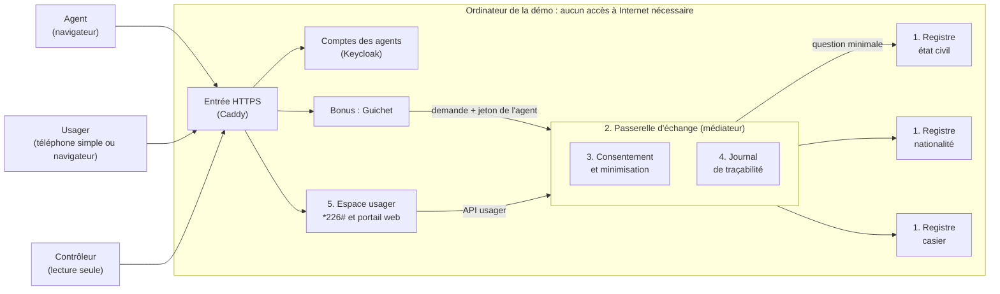

# Architecture de Griot Secure, couche par couche

Pour le jury et pour une administration qui voudrait réutiliser le socle.
Le sujet demande cinq couches : **registres, passerelle d'échange, consentement et minimisation, journal de
traçabilité, espace usager**. Le guichet et la résilience viennent en bonus. Cette page suit cet ordre.

- Les chemins des fichiers et les commandes sont tous dans [Où trouver quoi](OU_TROUVER_QUOI.md).
- Les règles, sans le logiciel : [REGLES_DU_SOCLE.md](REGLES_DU_SOCLE.md).
- État décrit : `main` au commit `2e2b4e4` (17/11/2026).

## En une phrase

Une **passerelle** fait circuler entre administrations des réponses courtes (« oui » / « non »). Ces réponses sont
**signées** par l'administration qui détient la donnée. L'usager **voit avant** ce qui part et **vérifie après**
qui a consulté ses données.

## Vue d'ensemble

Les réseaux internes n'ont **aucune sortie vers Internet**. Seule l'entrée HTTPS publie les ports 80 et 443 sur
l'ordinateur. La passerelle et les registres ne sont jamais publiés. Le guichet n'est pas sur le réseau des
registres : il ne peut pas contourner la passerelle.

## Trajet d'une demande de passeport, à travers les couches

Démarche « Passeport ordinaire » : **avec l'accord de l'usager**. Deux questions seulement : « burkinabè ? » et
« interdiction de sortie du territoire ? ». L'état civil n'est pas interrogé. L'histoire racontée :
[SCENARIO_PASSEPORT.md](SCENARIO_PASSEPORT.md).

| Étape | Couche | Ce qui se passe |
|---|---|---|
| 1 | Guichet | L'agent se connecte (mot de passe + code TOTP), choisit la démarche, tape l'identifiant de l'usager |
| 2 | Passerelle | Reçoit la demande avec le jeton de l'agent. **Le service vient du jeton, jamais du formulaire** |
| 3 | Consentement et minimisation | Vérifie : démarche prévue, service autorisé, finalité exacte, limites de l'agent. Sinon : refus avec motif |
| 4 | Passerelle | Pose les deux questions **en parallèle**, avec un délai maximal (3 secondes) |
| 5 | Registres | Chaque registre vérifie lui-même qui demande et s'il y a droit, calcule la réponse, la **signe** |
| 6 | Passerelle | Vérifie chaque signature et le contenu. Un seul écart : refus et alerte |
| 7 | Espace usager | L'usager lit l'aperçu exact (« L'ONI (passeports) recevra : … Rien d'autre. ») et confirme ou refuse, dans les 10 minutes |
| 8 | Guichet | Reçoit les réponses, **revérifie** les signatures, affiche le résultat. La passerelle efface la réponse qu'elle gardait |
| 9 | Journal | Chaque étape est notée (le fait, jamais la valeur). L'usager reçoit un **reçu** |
| 10 | Espace usager | Plus tard, « Qui a consulté mes données » montre la consultation |

Pour une démarche **en base légale** (concours, majorité), l'étape 7 n'existe pas : la réponse est remise tout de
suite. La consultation apparaît quand même dans l'historique de l'usager, avec le texte qui l'autorise.

---

## Couche 1 : Registres

> ⚠️ **Provisoire.** Le jury publiera un **contrat OpenAPI commun** pour les registres d'état civil, de
> nationalité et de casier. Ce qui suit décrit nos **registres simulés** d'aujourd'hui. La forme des échanges avec
> les registres (adresses, champs, format des réponses) sera alignée sur ce contrat : **rien n'est définitif ici.**

**Rôle.** Chaque registre garde ses données et ne répond qu'à la question posée, par « oui » ou « non ». Il ne
renvoie jamais la fiche : ni date de naissance, ni filiation, ni détail du casier.

**Ce que fait le prototype**

- Un seul code de registre, lancé trois fois : état civil, nationalité, casier judiciaire.
- Chaque registre est décrit par un **fichier YAML** (un « adaptateur »). Ce fichier dit où sont les données
  (CSV, Excel, JSON, base SQLite ou SQL, PDF texte, API), quel champ identifie une personne, comment calculer
  chaque réponse, et quels cas refuser. Brancher un nouveau registre = écrire ce fichier, sans changer le code.
- Les cas douteux donnent un **refus**, jamais une supposition :
  - aucune fiche → « introuvable » ;
  - plusieurs fiches → « identité ambiguë » ;
  - date incomplète (« né vers 1990 ») → « donnée insuffisante » ;
  - personne décédée → refus, avec un motif public neutre.
- Chaque registre **signe** ses réponses, refus compris, avec sa propre clé (JWT EdDSA / Ed25519, valable
  10 minutes). La clé privée est créée au premier démarrage, dans un espace que lui seul peut lire.
- **Double clé, côté registre.** Le registre vérifie lui-même le jeton de l'agent et refuse ce qu'il n'a pas
  autorisé : un service qui n'a pas droit à l'attribut, un seuil d'âge non déclaré, un mode (accord ou base légale)
  non accepté pour ce service.
- **Double trace.** Chaque registre garde sa propre liste des réponses signées : numéro de demande, date, service,
  attribut, ok ou refus. Jamais la personne, jamais la valeur.
- **Données du jury.** On les branche par configuration : fichier YAML, conversion d'un PDF scanné sans réseau,
  ou relais vers l'API du jury. Voir [JOUR_J_DONNEES_JURY.md](JOUR_J_DONNEES_JURY.md).

## Couche 2 : Passerelle d'échange

**Rôle.** Faire circuler les questions et les réponses entre le service qui demande et les registres, **sans
pouvoir lire ni fabriquer** une réponse.

**Ce que fait le prototype (le « médiateur »)**

- Reçoit une demande : numéro unique, démarche, finalité, identifiant de l'usager, et le jeton de l'agent.
- Pose une question par registre, **toutes en parallèle**. Chaque registre a son délai (3 secondes au total) et
  son propre résultat.
- Vérifie chaque réponse :
  - signature avec la clé publique du bon registre ;
  - émetteur et destinataire ;
  - expiration ;
  - numéro de demande ;
  - numéro de réponse jamais vu avant ;
  - forme exacte du contenu.
- Une même demande envoyée deux fois n'est exécutée qu'une fois : le même résultat est renvoyé.
- Ne publie rien vers l'extérieur. Les administrations l'appellent par une API ([API.md](API.md)).
- **Clés publiques.** Chaque registre écrit la sienne dans un espace à lui. La passerelle et le guichet la lisent
  sans pouvoir la modifier : la passerelle ne peut donc pas substituer une fausse clé.

**Ce qu'elle ne peut pas faire.** Elle n'a pas la clé des registres. Si elle changeait « non » en « oui », la
signature ne correspondrait plus, et le guichet le verrait.

## Couche 3 : Consentement et minimisation

**Rôle.** Ne transmettre que l'utile, et seulement avec l'accord de l'usager ou un texte qui l'autorise.

**Ce que fait le prototype**

- **Catalogue des démarches** (fichier YAML). Pour chaque démarche, il fixe à l'avance :
  - le nom de la démarche ;
  - les services autorisés ;
  - la **finalité** ;
  - la **base** : accord de l'usager, ou base légale avec le texte cité ;
  - la **liste exacte des réponses** demandées.
  Rien d'autre ne peut être demandé. Une finalité différente est refusée (« finalité non autorisée »).
- Le catalogue est **vérifié à chaque modification**, sans redémarrage. Une version invalide est refusée et
  l'ancienne reste en vigueur. L'empreinte du catalogue est écrite au journal : on sait quelles règles
  s'appliquaient lors de chaque consultation.
- **Double clé** : le catalogue dit qui peut demander quoi, et chaque registre le revérifie de son côté
  (couche 1). Si l'un des deux dit non, la réponse est non.
- **Minimisation de l'âge** : le registre répond à « a-t-il entre 18 et 37 ans au 31/12/2026 ? », jamais par la
  date de naissance. La majorité civile est à 18 ans (loi n°012-2025/ALT, [source](https://burkina24.com/?p=418360)),
  et ce seuil est un paramètre.
- **Accord de l'usager** : la réponse minimale attend la confirmation de l'usager pendant 10 minutes au plus,
  puis elle est **effacée** dès qu'elle est remise ou expirée. L'usager peut refuser, ou retirer son accord.
  La loi n°001-2021/AN demande un consentement « exprès, libre, spécifique et éclairé » et des données
  « adéquates, pertinentes et non excessives »
  ([source](https://assembleenationale.bf/storage/Loi/kDsWHXOTUCQFVESChh8BlBdiZnCrdTsOpXe1rzmH.pdf)).
- **Limites** : au-delà de 5 citoyens différents par heure, un agent est bloqué ; au-delà de 5 demandes d'un même
  service sur une même personne en 24 heures, refus. Chaque fois, une alerte apparaît dans l'historique des
  personnes concernées.
- Un outil de preuve cherche les données d'une personne partout hors des registres, et montre qu'elles n'y sont pas.
- Ajouter une démarche : [AJOUTER_UNE_DEMARCHE.md](AJOUTER_UNE_DEMARCHE.md).

## Couche 4 : Journal de traçabilité

**Rôle.** Prouver qui a consulté quoi, quand et pourquoi, et que personne n'a modifié cette preuve.

**Ce que fait le prototype**

- Chaque événement est une ligne. Le journal contient ces événements :
  - la demande ;
  - la réponse du registre ;
  - la confirmation ou le refus de l'usager ;
  - la remise ou l'expiration ;
  - le retrait d'un accord ;
  - les alertes ;
  - le chargement du catalogue ;
  - le canal (USSD ou web) quand l'usager agit.
- **Le fait, jamais le contenu** : « le service des passeports a consulté la nationalité de X pour un passeport »,
  jamais « burkinabè = oui ».
- L'usager y est **pseudonymisé** : son identifiant est remplacé par un code calculé avec un secret (HMAC-SHA256).
  L'espace usager recalcule ce code pour retrouver ses lignes.
- **Chaînage** : chaque ligne contient l'empreinte SHA-256 de la précédente. Modifier une ligne casse la chaîne
  à cet endroit, et le vérificateur indique la ligne exacte. La base refuse aussi toute modification ou
  suppression.
- **Reçu** : les 16 premiers caractères de l'empreinte de la ligne, remis à l'usager. Si quelqu'un recalculait
  toute la chaîne, les reçus déjà donnés ne correspondraient plus.
- **Double trace** : le vérificateur compare le journal aux listes tenues par chaque registre. Une consultation
  effacée du journal se voit quand même.
- **Archiver, jamais effacer** : avant une démo, le journal est mis de côté avec sa date, et il reste vérifiable.
- Ce qui n'est pas protégé : [LIMITES.md](../LIMITES.md).

## Couche 5 : Espace usager

**Rôle.** Montrer à l'usager, **avant**, ce qui va partir, et lui montrer, **après**, qui a consulté ses données.

**Ce que fait le prototype**

- **Téléphone simple, `*226#`** (USSD simulé, écrans de 160 caractères au plus). C'est l'écran principal, pour
  les usagers sans smartphone.
  - Menu : 1. Demandes en attente, 2. Qui a consulté mes données, 3. Retirer un accord, 4. Langue, 0. Quitter.
  - Aperçu exact : « L'ONI (passeports) recevra : burkinabè = oui ; interdiction de sortie du territoire = non.
    Rien d'autre. 1. Confirmer 2. Refuser ».
  - Historique : 3 lignes par écran ; le détail donne le service, la finalité, la base et le reçu.
- **Portail web** (`/portail`, conteneur séparé) : les mêmes écrans dans un navigateur, sans JavaScript. S'il
  s'arrête, le `*226#` continue.
- **Connexion de démonstration** : numéro de téléphone + code PIN fictifs, bloqués 5 minutes après 3 erreurs.
  En production : l'identifiant unique électronique ([LIMITES.md](../LIMITES.md)).
- Les deux écrans passent **uniquement** par l'API usager de la passerelle ([API_USAGER.md](API_USAGER.md)). Ils
  n'ont aucun accès aux registres ni au journal. Chaque écran a son propre secret, et le canal est écrit au journal.
- **Langues** : français. Sur le `*226#`, le mooré n'est proposé que lorsque **toutes** les phrases et toutes les
  finalités sont traduites ; le portail web reste en français pour l'instant. Nous n'inventons jamais de mooré.

---

## Bonus : Guichet

- Écran de l'agent, rendu par le serveur, sans JavaScript. Il propose **seulement** les démarches du catalogue.
- **Comptes des agents** (Keycloak) : mot de passe d'au moins 12 caractères, code TOTP obligatoire, blocage après
  5 échecs. Le **groupe** de l'agent dans Keycloak donne son service.
- **Revérifie** chaque signature avec la clé publique du registre, lue sans passer par la passerelle. Il affiche
  « signé par le registre…, signature vérifiée, valable jusqu'à… » et l'empreinte courte de la clé.
- Une réponse partielle n'est jamais présentée comme complète : « résultat incomplet, aucune conclusion. Rien n'a
  été deviné ».
- **Page Contrôle** (rôle `controleur`, lecture seule) : alertes, état des registres, catalogue en vigueur et son
  empreinte, vérification du journal. Aucun identifiant d'usager, aucune réponse, aucune action possible.

## Bonus : Résilience

Règle d'or : **en cas de doute, refuser, ne jamais deviner.**

| Panne | Ce qui se passe |
|---|---|
| Registre coupé | « Registre indisponible, rien n'a été deviné », ligne au journal |
| Registre lent | Abandon après 3 secondes, même message |
| Réponse falsifiée en chemin | Signature invalide : refus et ligne d'alerte |
| Un registre en panne sur trois | Résultat partiel, ligne par ligne. **Jamais de « oui » global** |
| Même demande envoyée deux fois | Une seule exécution, même résultat |
| Passerelle injoignable | Le guichet et l'espace usager l'affichent clairement, rien n'est deviné |
| Portail web arrêté | Message clair, le `*226#` continue |
| Ligne du journal modifiée dans le fichier | Le vérificateur donne le numéro de la ligne |
| Wifi coupé | Tout continue : rien ne dépend d'Internet. Les images peuvent être rechargées sans réseau |

Pour provoquer chaque panne pendant la démo, il y a un interrupteur de panne et un banc de pannes automatique
([Où trouver quoi](OU_TROUVER_QUOI.md), [test-manuel.md](test-manuel.md)).

---

## Qui voit quoi

| Acteur | Voit | Ne voit jamais |
|---|---|---|
| **Agent du guichet** | Les réponses signées à **ses** demandes (« burkinabè : oui »), ou le motif du refus | La fiche, la date de naissance, la filiation, le détail du casier. Les demandes des autres agents |
| **Passerelle** | L'identifiant de l'usager le temps de la demande. La réponse minimale signée, **seulement jusqu'à la remise ou l'expiration**. Le journal : des faits, avec l'usager pseudonymisé | La fiche. Aucune valeur dans le journal. Elle ne peut pas fabriquer de réponse |
| **Registre de l'état civil** | Ses propres fiches. Les questions qu'on lui pose : qui demande, sur qui, quelle réponse | Les réponses des autres registres. Ce que l'usager a confirmé |
| **Registre de la nationalité** | Idem, pour ses fiches | Idem |
| **Registre du casier** | Idem, pour ses fiches | Idem |
| **Usager** | Avant l'envoi : exactement ce qui partira (valeurs comprises : ce sont ses données). Après : qui a consulté, quand, pourquoi, sur quelle base, son reçu, les alertes le concernant | Les données des autres personnes |
| **Contrôleur** | Alertes, état des registres, catalogue en vigueur, vérification du journal | Aucun identifiant ni pseudonyme d'usager, aucune réponse. Il ne peut rien modifier |

## Signatures, en bref

- **Aucune cryptographie écrite par l'équipe.** Signatures : bibliothèque PyJWT (EdDSA / Ed25519) avec
  `cryptography`. Journal : SHA-256 (`hashlib`). Pseudonymes : HMAC (`hmac`). Détail : [DEPENDANCES.md](DEPENDANCES.md).
- Le registre signe ; la passerelle vérifie ; le guichet revérifie.
- Seul « indisponible » n'est pas signé, puisque le registre n'a pas répondu. Un refus non signé est traité comme
  une réponse corrompue.
- Le format exact des réponses signées des registres dépendra du contrat OpenAPI du jury (couche 1).

## Pourquoi pas de base centrale

Une base qui copierait l'état civil, la nationalité et le casier permettrait de **tout croiser** sur chacun, et
deviendrait la cible la plus intéressante pour un attaquant. Ici, **chaque registre garde ses données** et ne
répond qu'à des questions prévues à l'avance. La passerelle ne stocke aucune fiche. Elle garde une réponse
minimale quelques minutes au plus, et un journal de faits sans valeurs.

Une donnée fausse se corrige **à la source**, auprès du registre qui la détient (règle 10 du socle). Il n'y a pas
de copie à corriger ailleurs. Et pour le passeport, la réponse « burkinabè : oui » suffit : la copie du
certificat de nationalité n'est pas nécessaire. C'est ce que demande la loi n°001-2021/AN : des données
« adéquates, pertinentes et non excessives ».

## Pourquoi pas X-Road, et comment y aller

X-Road est une couche d'échange de données libre, utilisée par plusieurs États. Nous ne l'avons pas déployée :
c'est trop lourd à installer et à faire tourner en trois jours, sur un seul ordinateur, sans réseau. Mais nous
avons repris ses idées, pour qu'une migration reste possible.

| Dans Griot Secure | Équivalent dans X-Road |
|---|---|
| Registre (couche 1) | Fournisseur de service |
| Guichet, ou tout logiciel métier qui appelle la passerelle | Client de service |
| Annuaire des services et des registres | Configuration globale diffusée par le serveur central |
| Double clé : le registre déclare qui a droit à quoi | Droits d'accès définis par le fournisseur du service |
| Journal chaîné + double trace (couche 4) | Journal des messages de chaque serveur de sécurité |
| Rôle `controleur`, en lecture seule | Rôle « Security Officer » |
| TLS mutuel entre systèmes (prévu, voir [API.md](API.md)) | TLS mutuel entre serveurs de sécurité |

Ce qui resterait propre à Griot Secure, au-dessus d'X-Road :
- le catalogue des démarches et des finalités, et l'accord de l'usager (couche 3) ;
- l'espace usager et son reçu (couche 5) ;
- les réponses minimales signées par le registre.

Dans une migration, chaque registre se placerait derrière un serveur de sécurité, et la passerelle deviendrait
un client de service. Ce n'est pas commencé, et la forme exacte dépendra du contrat des registres (couche 1).
C'est noté comme piste dans [fiche-oral.md](fiche-oral.md) (question 39).
